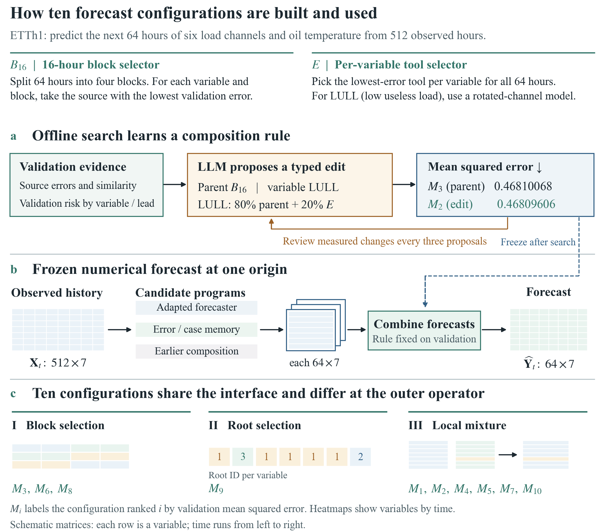

# LLM-TS · 让语言模型参与时序预测

把同一段历史交给几个预测模型，它们往往会在不同的地方出错：有的擅长预测接下来的几步，有的能更好地跟上某个变量的日周期。我们想知道，语言模型读过这些误差之后，能不能提出一个值得采用的修改？

ETTh1 实验里有一个很小的例子。原方案已经能预测七个变量未来64小时的变化。DeepSeek 提议保留其中六个变量的预测，只改负荷变量 LULL：原预测占 80%，另一个工具占 20%。程序在验证集上检查了这项提议，整体均方误差从 0.46810068 降到 0.46809606。接下来又有一个修改在验证集上排到了第一，但它在测试集上的误差反而略高。这也是我们把十种配置放在一起研究的原因：既想知道 LLM 提出了什么，也想知道哪些改动经得起后续数据的检验。

**想了解方法，可以先读[《LLM 辅助的时序专家组合》HTML 论文](reports/agentic_ts_forecast/ETTh1_Top10_NeurIPS_Style.html)。** 图1展示 LLM 在哪一步参与研究，图2到图4用油温这一个变量串起三类预测方法。GitHub 文件页显示 HTML 源码，点击 **Download raw file**，再用浏览器打开即可阅读。公式和图片都包含在文件里。

**想自己跑一遍，可以从[新同学操作手册](methods/agentic_ts_forecast/README.md)开始。** 两个实验适合回答不同的问题：

| 如果你想…… | 推荐从这里开始 |
|---|---|
| 弄清 ETTh1 上十种方法为什么得分接近 | 用手册里的 ETTh1 命令复现十种组合，再对照[完整指标表](methods/agentic_ts_forecast/evaluation/top10_results.csv)。 |
| 给一段新历史，实际预测后面会发生什么 | 用 ETTm1 的冻结模型。输入512条连续的15分钟观测，它会返回接下来16小时的七变量预测。 |
| 让 LLM 再提一批规则 | 在完成验证后，按手册配置自己的方舟密钥并启动新一轮提案。日常预测只运行已经选好的数值工具。 |

从 ETTh1 转到 ETTm1，我们保留了“512步历史预测64步”以及十种组合规则，重新拟合了一个可以独立部署的轻量工具池。ETTm1 上，LLM 从验证反馈中重新找到了已有的 M1 规则。最终按验证误差选出的方案来自程序搜索，它的测试 MSE 为 **0.271542**，同窗口 DLinear 为 **0.292529**。[ETTm1 结果表](methods/agentic_ts_forecast/transfer/artifacts/ETTm1/results.csv)

这个分支沿用了仓库里的[方向标签研究](https://github.com/Zhang666zhao/LLM-TS/tree/research/direction-conditioned-forecasting)。查找早期实验与模型时，可以从[历史研究报告](reports/oracle_v1/report.md)或[历史权重 Release（不含数据）](https://github.com/Zhang666zhao/LLM-TS/releases/tag/forecast-weights-20261102)进入。
